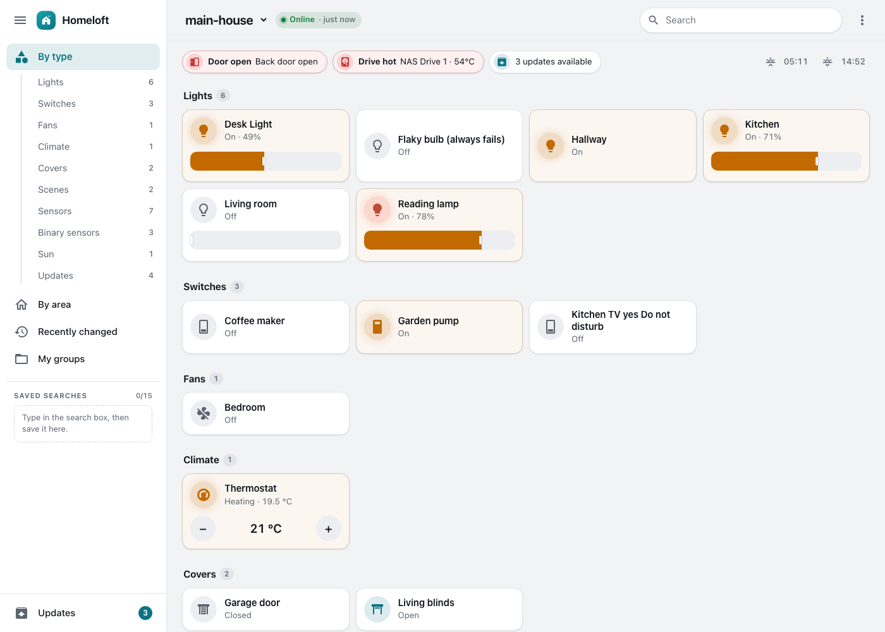
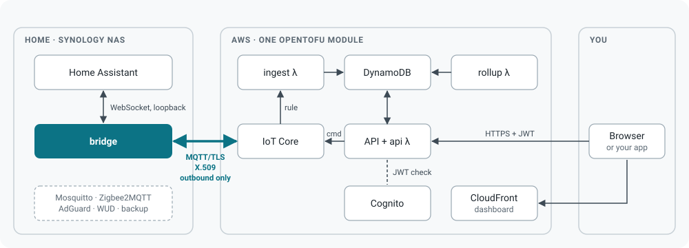

  

<h1 align="center">Homeloft</h1>

  <strong>Home Assistant on your Synology, with your own cloud dashboard and API on AWS.</strong> 
  No open ports. No subscription. About US$1–3 a month, on infrastructure you own.

  
  
  
  

  <a href="https://homeloft.dev/demo/"><strong>Try the live demo</strong></a> ·
  <a href="docs/quickstart.md">Quickstart</a> ·
  <a href="https://homeloft.dev">Docs</a> ·
  <a href="docs/architecture.md">Architecture</a>

  

## Why Homeloft

You run Home Assistant at home because you want your house to keep working without someone else's
cloud. But you still want to check on the house from your phone, and maybe call it from your own apps.
Homeloft adds that cloud half **without opening a single port at home**, as code you deploy
into your own AWS account.

## Features

- **Local first.** Home Assistant runs on the NAS in Docker. Automations keep working when the internet is down.
- **No inbound connections.** A small bridge container dials *out* to AWS IoT Core over mutual TLS. No port
  forwarding, no reverse proxy, no tunnel into Home Assistant.
- **A real dashboard.** Lights with brightness and colour, thermostats, covers, scenes, sensors, history,
  areas, groups and saved searches, in light and dark. Changes show instantly and roll back if the house says no.
- **Safe by default.** Commands pass two allowlists, one in the cloud and one at home, and `lock.unlock` is
  in neither. Stale and replayed commands are rejected. TOTP MFA is on by default. [Security model](docs/security.md)
- **Infrastructure as code.** One OpenTofu module (Terraform works too): HTTP API, Cognito, DynamoDB, IoT Core
  and an optional CloudFront site on your own domain. Deploy from your laptop or from GitHub Actions.
- **Built to embed.** Drop the module into an existing stack with your existing Cognito pool, mount
  `<HomeloftDashboard>` in your React app, or call the [HTTP API](docs/contract.md#http-api-v1-cognito-jwt-on-every-route-except-v1health) from anything.
- **Batteries for the NAS.** Optional Zigbee2MQTT, AdGuard Home, container health sensors, update notices
  and daily backups, with every [Synology quirk](docs/synology.md#synology-gotchas) we hit written down.

## How it works

  

Home Assistant talks to the bridge over a local WebSocket. The bridge publishes state to IoT Core and receives
commands on the same outbound connection. Lambdas store state in DynamoDB and serve the API. More in
[Architecture](docs/architecture.md); the wire format is in the [contract](docs/contract.md).

## Quickstart

You need an AWS account, a Synology NAS (or any Docker host) for Home Assistant, and OpenTofu 1.10+.
Budget about an hour for the first deploy.

1. **Cloud:** create the state bucket (`cloud/terraform/bootstrap`), then `tofu apply` in `cloud/terraform/examples/standalone`.
2. **NAS:** make a key and CSR on the NAS, put the certificate in place, fill in `.env` and start the Compose project.
3. **Web:** run `./scripts/deploy-web.sh`, create your user and sign in.

**Follow the full [Quickstart](docs/quickstart.md)**: it has a smoke test after every step.
No AWS yet? `cd web && npm ci && npm run dev:mock` runs the dashboard on fake data, or open the [demo](https://homeloft.dev/demo/).

## Documentation

| | |
|---|---|
| [Quickstart](docs/quickstart.md) | First deploy, end to end |
| [Synology guide](docs/synology.md) | The NAS stack on DSM 7.2, with gotchas |
| [Configuration](docs/configuration.md) | Every module input and output, and every `.env` key |
| [Upgrading](docs/upgrading.md) · [Troubleshooting](docs/troubleshooting.md) | Day two |
| [Architecture](docs/architecture.md) · [Contract](docs/contract.md) · [Security model](docs/security.md) | How it fits together, and why |
| [Integrating](docs/integrate.md) | The module in an existing stack, the API from your apps, cost |
| [Contributing](CONTRIBUTING.md) · [Changelog](CHANGELOG.md) · [Releasing](docs/releasing.md) | The project |

## FAQ

**Why not Nabu Casa (Home Assistant Cloud)?**
For most people Nabu Casa is the better choice, and we recommend it if you want zero ops. It gives you secure
remote access to the full Home Assistant UI, voice assistant integrations and more, set up in minutes,
and your subscription funds Home Assistant's development. Homeloft is for people who *want* to own the cloud
half: run it in their own AWS account, define it as code, build their own apps on a documented API, or
embed the dashboard in something they already run. It is a smaller dashboard, not the full HA UI, and
you maintain it. If none of that appeals, use Nabu Casa.

**Does it need a Synology?**
No. The NAS side is a plain Docker Compose project. The docs are written for Synology DSM 7.2 because that is
where Homeloft runs every day, and DSM has quirks worth writing down. Any Linux host with Docker works.

**What happens when the internet or AWS is down?**
Home Assistant keeps running every automation locally. The dashboard shows the home as offline until the bridge
reconnects, which it does by itself with backoff.

**What does it cost?**
About US$1–3 a month for one home at typical use: IoT messages, Lambda, on-demand DynamoDB and CloudFront.
The assumptions are in [Integrating: cost](docs/integrate.md#cost-estimate-one-home).

**Can the cloud unlock my door?**
Only if you allow it in two places: the module's `allowed_services` and the bridge's `BRIDGE_ALLOWED_SERVICES`.
Both leave out `lock.unlock`, alarms and scripts by default. Because the bridge checks its own list, a compromised
AWS account still can't call a service the house doesn't allow.

**Terraform or OpenTofu?**
Both. The module avoids OpenTofu-only syntax. The examples use S3 native state locking, which needs version 1.10 or later of either.

**Mobile apps?**
Planned as one Expo app for Android and iOS, reusing the dashboard's API client. See the [mobile plan](docs/mobile.md).

## Contributing

PRs are welcome against `develop`. Please read [CONTRIBUTING.md](CONTRIBUTING.md) and the
[Code of Conduct](CODE_OF_CONDUCT.md) first. Coding agents: see [CLAUDE.md](CLAUDE.md) (also `AGENTS.md`).
Report security issues through [SECURITY.md](SECURITY.md), not public issues.

## License

[MIT](LICENSE)
