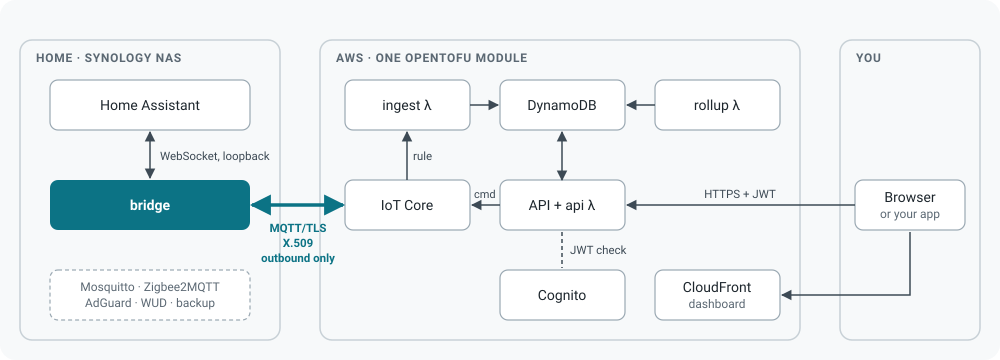

# Architecture

Homeloft has three parts, built separately against one shared [contract](contract.md):
the **NAS stack** (Home Assistant plus a bridge), the **cloud module** (AWS, as OpenTofu) and the
**web app** (React). The rule that shapes everything: **the home only makes outbound connections.**

## The NAS stack (`nas/`)

A Docker Compose project. Home Assistant does the real work and keeps doing it when the internet is down.

| Service | Role |
|---|---|
| `homeassistant` | Home Assistant, host networking |
| `mosquitto` | Local MQTT broker on `127.0.0.1`, for Zigbee2MQTT and WUD |
| `bridge` | The only container that talks to the internet (below) |
| `zigbee2mqtt` | Optional (`--profile zigbee`) |
| `adguard` | Optional LAN DNS (`--profile adguard`), on its own macvlan IP |
| `socket-proxy`, `monitor` | Read-only Docker state, published to HA as container sensors |
| `wud` | Checks images for updates. It only notifies ([Upgrading](upgrading.md)) |
| `backup` | Daily tarball of the config folders |

**The bridge** (`nas/bridge`, Python) subscribes to Home Assistant's WebSocket API, filters entities
(`BRIDGE_ALLOWED_DOMAINS`, `BRIDGE_ENTITY_EXCLUDE`) and publishes state to AWS IoT Core over MQTT with
mutual TLS. It subscribes to its home's command topic, checks each command against its own allowlist and
freshness rules, calls the HA service and publishes an acknowledgement. It runs as a non-root user on a
read-only filesystem with no capabilities.

## The cloud module (`cloud/terraform/modules/homeloft`)

About 60 resources, all named `{name_prefix}-*`:

| Piece | AWS service | Notes |
|---|---|---|
| Device identity | IoT Core Thing, certificate, policy | One per home. The policy limits a certificate to its home's topics |
| Ingest | IoT topic rule → `ingest` Lambda | Writes current state, online status, command acks and history |
| Storage | DynamoDB, one table (`{prefix}-state`) | Single-table design, on demand, PITR. Item layout in the [contract](contract.md#dynamodb-single-table-prefix-state) |
| API | API Gateway HTTP API → `api` Lambda | `/v1`, Cognito JWT authorizer, group check, publishes commands to IoT |
| History | EventBridge → `rollup` Lambda | Raw points for 35 days, daily summaries for 15 months |
| Sign-in | Cognito user pool, hosted (managed) login | TOTP MFA by default. Or bring your own pool |
| Dashboard | S3 (private) + CloudFront (OAC) | Optional. CSP and security headers, optional custom domain with ACM |

Lambdas are Python with boto3 only, zipped by OpenTofu: no build step and no layers. State lives in an
S3 bucket created once per account by `cloud/terraform/bootstrap`, which can also create a GitHub OIDC
deploy role.

## The web app (`web/`)

A React single-page app in three layers, so you can reuse as much or as little as you want:

| Layer | Path | Reuse |
|---|---|---|
| `HomeloftClient` | `web/src/client` | No dependencies, no DOM. Shared with the planned mobile app |
| `<HomeloftDashboard>` | `web/src/components` | Drop into any React app; theme with `--hl-*` CSS variables |
| Standalone shell | `web/src/App.tsx` | Loads `config.json`, signs in with Cognito (PKCE), shows the dashboard |

It polls the API every 5 seconds while visible, applies changes optimistically and rolls them back
when a command fails. The [live demo](https://homeloft.dev/demo/) is this app with an in-browser fake API.

## How a command travels

1. You tap a light. The app `POST`s `/v1/homes/{homeId}/commands` with your Cognito token.
2. API Gateway checks the JWT. The `api` Lambda checks your group, the home id, the entity and that the
   service is in `allowed_services`, stores the command as `pending` and publishes it to
   `homeloft/{homeId}/cmd`. It answers `202` with a command id.
3. The bridge receives it, rejects it if it's stale, replayed or not in `BRIDGE_ALLOWED_SERVICES`, and
   otherwise calls the Home Assistant service.
4. The bridge publishes the result to `…/cmd/ack`. The `ingest` Lambda marks the command `ok` or `error`.
5. The app polls the command until it finishes, and the next state batch shows the light on.

The full message, table and API definitions are in the [contract](contract.md). The security reasoning
behind each hop is in the [security model](security.md).
